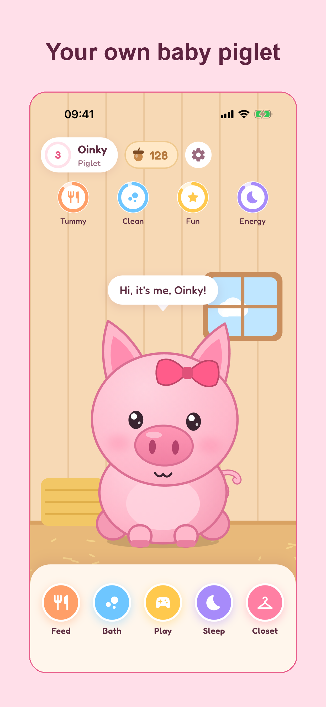
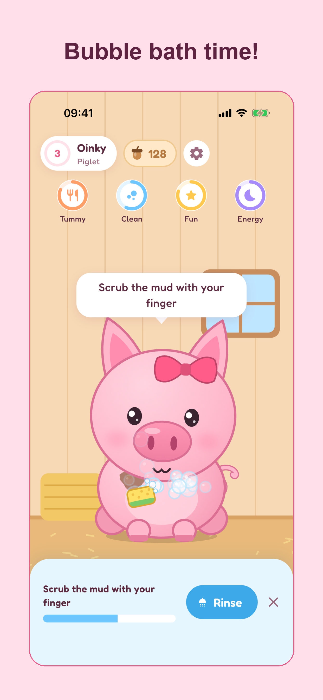
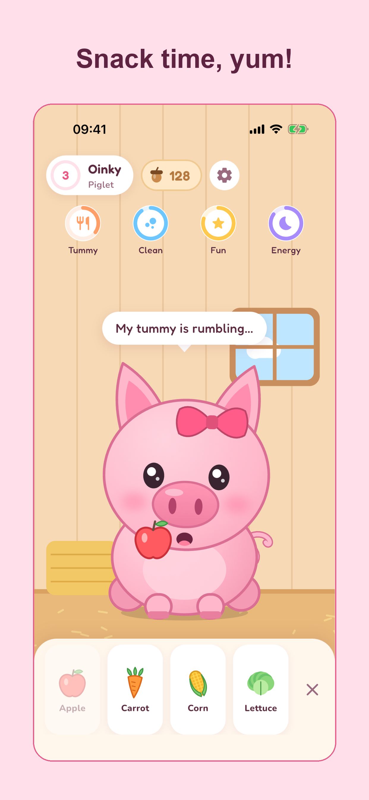

# Oink: Kawaii Baby Pig

A tiny piglet that lives in your iPhone and needs you: feed it by dragging snacks to its snout, give it bubble baths, rub its belly, tuck it in, and play Apple Catch for acorns to spend on hats, glasses and rooms. It grows from piglet to big pig as you care for it, and it never dies.

<p align="center">  </p>

> **Status: archived.** Oink was submitted to the App Store in 2026 but not released, and is no longer developed. This repository is published as-is, as a reference.

- **Stack:** Flutter (Dart 3.12), iPhone-first, portrait.
- **No account, no ads, no purchases.** Works offline.
- The pig, rooms and icons are all drawn in code; sounds are synthesized (`tools/audio/synth.py`).

## Run it

```bash
flutter pub get
flutter gen-l10n
flutter test
flutter run            # iOS simulator or device
```

## License

No open-source license is granted: the code, art and sound are © Ouadie Zerhouni, all rights reserved. You're welcome to read and learn from it; ask before reusing anything.

## Developer notes

The notes below were written while the app was in development. They mention internal files (planning notes, owner to-do lists) that may not be in this repository.

A kawaii baby-pig virtual pet for iPhone. Feed it by dragging snacks to its snout, give it bubble baths, rub its belly,
tuck it in, play Apple Catch for acorns, and spend them on hats, glasses and rooms. It grows from piglet to big pig as you care
for it. No ads, no in-app purchases, no account; works offline.

- Flutter 3.44 / Dart 3.12, iOS-first, iPhone portrait. Everything is drawn in code (pig, rooms, icons); sounds are synthesized
  (`tools/audio/synth.py`).
- Remote config: a public JSON on GitHub (`docs/REMOTE_CONFIG.md`).
- Store listing: `ASO.md`. What is left for the owner (accounts, device check, store page): `owner-todo.md`.
- Product spec: `SPEC.md`. Working notes for Claude Code: `CLAUDE.md`.

```bash
flutter pub get && flutter gen-l10n
flutter analyze && flutter test
flutter run
```
